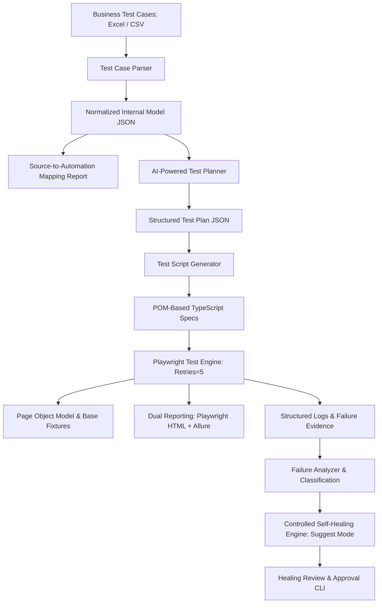

# Enterprise Playwright Automation Framework Architecture

## 1. Architectural Overview

The **Enterprise Playwright Framework** is an enterprise-grade UI automation architecture built with TypeScript, Node.js, and Playwright Test. It is purpose-built to parse, plan, generate, execute, and heal test automation suites derived directly from business test scenario repositories (Excel `.xlsx` and `.csv`).

## 2. Core Pillars

### 2.1 Page Object Model (POM) & Component Architecture
- **Separation of Concerns**: Test scripts contain test flow, preconditions, and assertions; Page Objects contain locators and reusable action methods.
- **Component Modals**: Complex UI interactions (`PayNowModal`, `AgreementModal`, `ReceiptModal`) are isolated into dedicated component objects, maximizing reusability across pages.
- **Resilient Locators**: Prioritizes accessible locators (`getByRole`, `getByLabel`, `getByPlaceholder`, `getByText`, and test IDs) over fragile XPath/CSS selectors.

### 2.2 Reusable Fixtures & Secure Authentication State
- **Session Reuse**: Authentication is isolated in `auth.setup.ts`, saving storage state to `auth/user-state.json`. Tests load this storage state, eliminating redundant UI logins.
- **Test Independence**: Each test runs in an independent browser context to prevent test crosstalk while reusing authenticated cookies and session storage.
- **Secret Redaction**: Passwords, tokens, and credit card PANs are automatically redacted from console outputs, logs, and artifacts.

### 2.3 Five-Retry Resilience Policy
- **Configured Retries**: `retries: 5` (1 initial attempt + 5 retries = 6 attempts maximum).
- **Attempt Tracking**: Each attempt is tracked independently with attempt-specific screenshots, traces (`retain-on-failure`), and structured logs.
- **Flakiness Detection**: Distinguishes consistently failing tests from tests that passed on a retry.

### 2.4 Controlled Self-Healing System
- **Three Operational Modes**:
  - `off`: Healing disabled.
  - `suggest`: Analyzes errors, inspects DOM evidence, and produces proposed code diffs without modifying source code (default).
  - `approved`: Changes applied only after human approval.
- **Strict Safety Rules**: Never alters expected results, never weakens assertions, and never deletes validation checks.

### 2.5 Dual Reporting Architecture
- **Playwright HTML Reporter**: Native, dependency-free interactive HTML report with step execution times, screenshots, and embedded trace viewer.
- **Allure Reporting**: Enterprise dashboard with epic/feature/story breakdowns, trends, retry history, failure categorization, and environment metadata.
