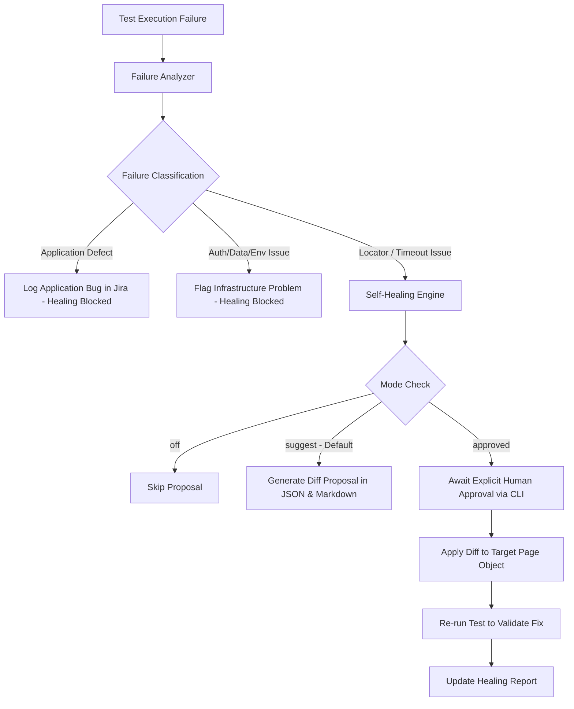

# Controlled Self-Healing System Specification

## 1. Controlled Self-Healing Workflow

The self-healing mechanism operates under strict governance rules to prevent false-positive passing tests or silent mutation of business logic.



## 2. Safety Rules & Guardrails

1. **Assertion Integrity**: Assertions and expected values are NEVER weakened, altered, or deleted to force a test to pass.
2. **Deterministic Suggest Mode**: In `suggest` mode (default), source files are never written to or modified. Proposals are recorded in `logs/healing-proposals.json` and `logs/healing-report.md`.
3. **Approval Lifecycle**: In `approved` mode, changes are only applied after human review via:
   ```bash
   npm run test:heal:review
   ```
4. **Validation Proof**: A healed test is never marked as passed until it has been re-executed against the target environment.
